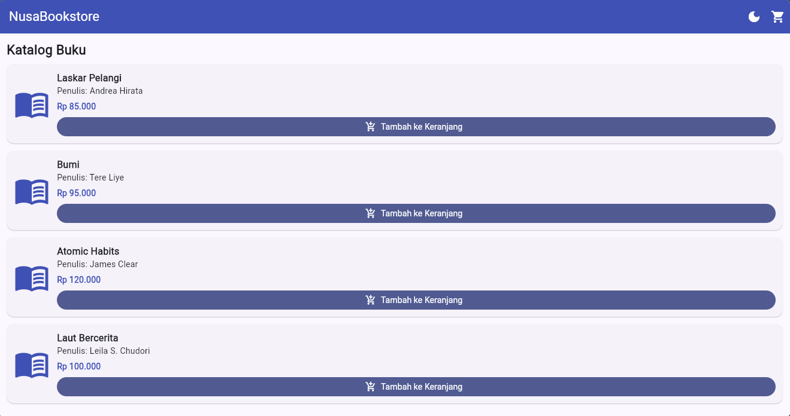
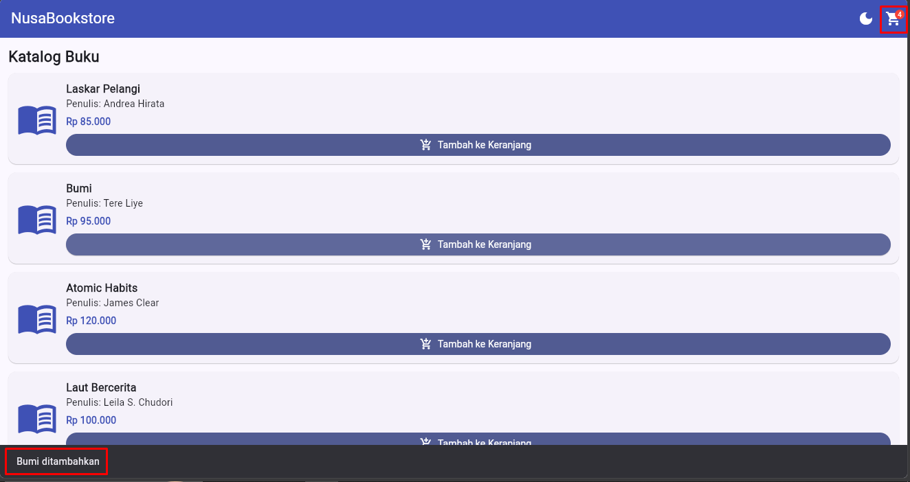
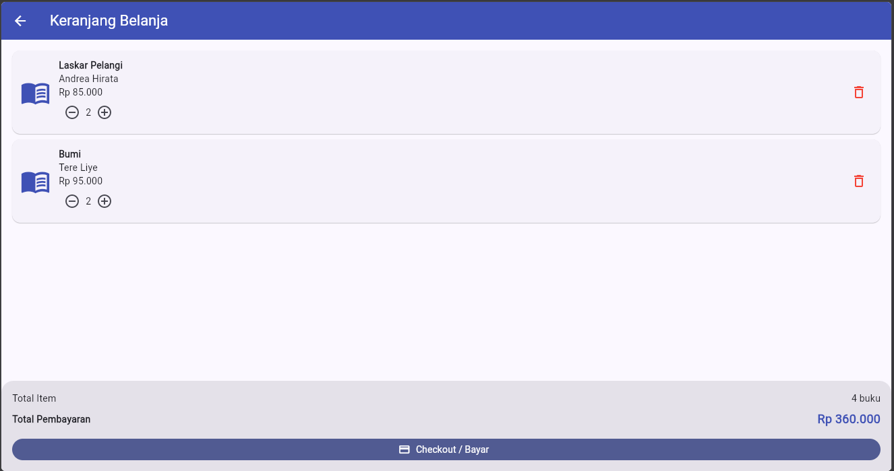
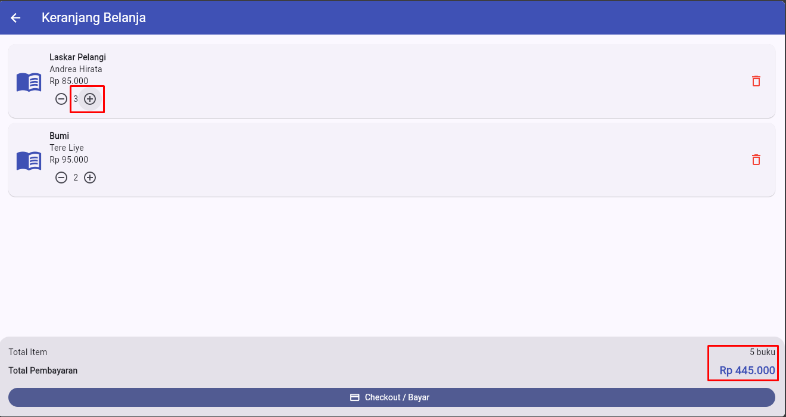
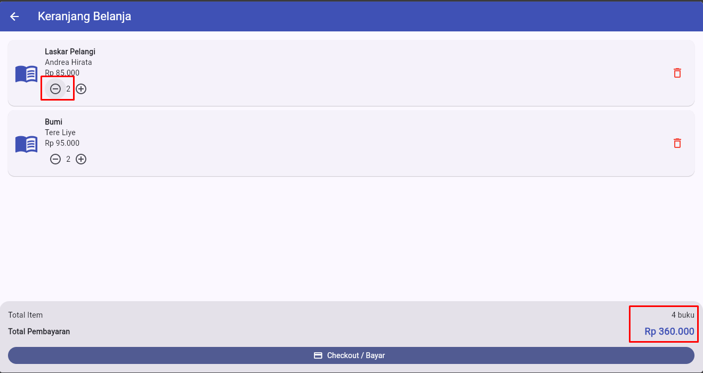
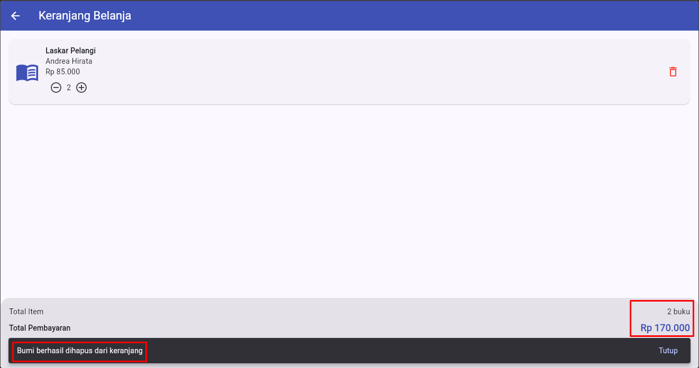
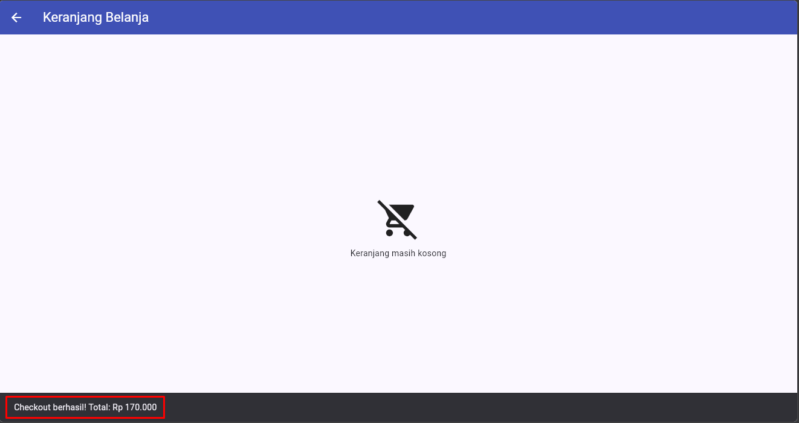
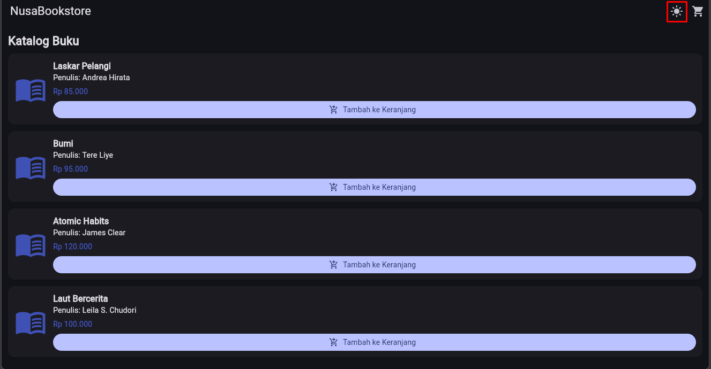
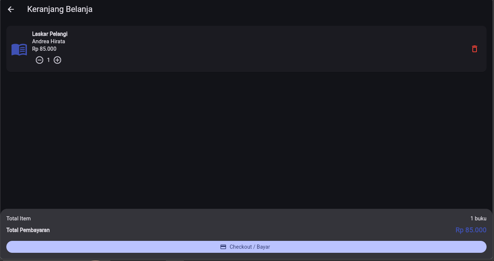

# PPM Sesi 3 - Statet Management

## Identitas

- **Nama:** Mochamad Ramdhan Irawan
- **NIM:** 20240040199
- **Prodi/Kelas:** Teknik Informatika / TI24G

---
## Halaman Utama

  

---
## Tambah Produk

  

<h3> ketika tombol "Tambah Keranjang" diklik, akan muncul notifkasi dan icon chart di pojok kanan atas terupdate</h3>

---
## Halaman Keranjang

  

  

<h3> Ketika tombol "+" diklik maka angka akan bertambah dan total harga juga bertambah</h3>

  

<h3> Ketika tombol "-" diklik maka angka akan berkurang dan total harga juga berkurang</h3>

  

<h3> Ketika icon hapus diklik maka data akan dihapus semuanya dan total harga juga berkurang</h3>

  

<h3> Ketika chekcout barang, muncul snackbar dibawah dan juga keranjangnya kosong</h3>

---
## Dark Mode

  

  

